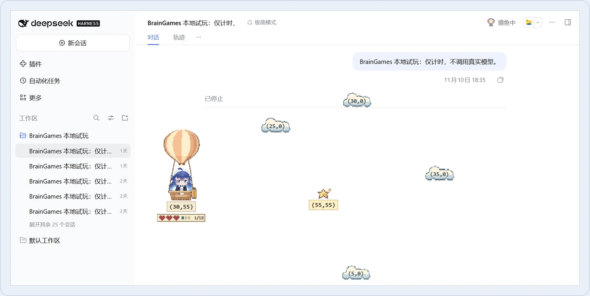
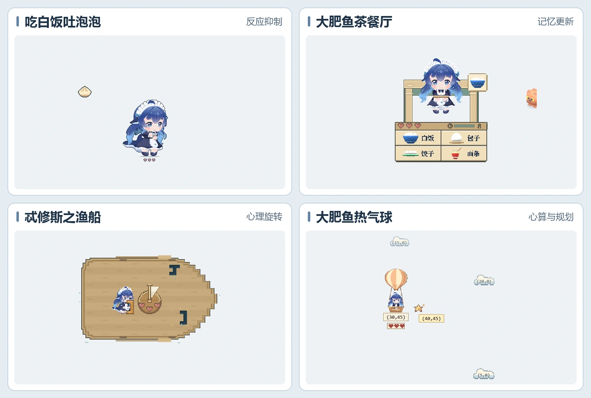

<div align="center">

<h1>dsh-braingames</h1>

<p>在 DeepSeek Harness（DSH）里，等 Agent 执行任务时做几分钟认知训练。</p>

<p>
  <a href="#安装"></a>
  <a href="https://github.com/hmhm2333/dsh-braingames/blob/HEAD/LICENSE.txt"></a>
</p>

<p>
  <a href="#游戏与训练目标">游戏与训练目标</a> ·
  <a href="#安装"><strong>安装</strong></a> ·
  <a href="#设置">设置</a> ·
  <a href="#为什么做认知训练">为什么做认知训练</a> ·
  <a href="#我是谁">我是谁</a> ·
  <a href="https://github.com/hmhm2333/dsh-braingames/issues">问题反馈</a>
</p>

</div>

**Agent 跑任务 → 做几轮练习 → 切回工作时暂停 → 下个空档继续。** 游戏叠在 DSH 的透明舞台上，点击空白处仍能操作工作区。

<p align="center">
  
  <br />
  <sub>DeepSeek Harness 实机画面 · 大肥鱼热气球</sub>
</p>

## 游戏与训练目标

<p align="center">
  
</p>

| 游戏 | 主要认知能力 | 几分钟里反复做什么 |
| --- | --- | --- |
| **吃白饭吐泡泡** | 反应抑制、选择性注意 | 按空格接裸露的食物；遇到单独的泡泡、包着食物的泡泡或红牌标出的食物时忍住不按。越往后判断时间越短。 |
| **大肥鱼茶餐厅** | 工作记忆更新、间隔回忆 | 等顾客停稳再给它上菜，记住新订单；未重新明示时按旧单上菜。难度上升后要同时记住更多顾客。 |
| **忒修斯之渔船** | 视觉空间表征、心理旋转 | 在脑中旋转手头木板，选出形状匹配的船身破口。后面会有更复杂的轮廓和更多备选破口。 |
| **大肥鱼热气球** | 带符号的心算、多步规划 | 计算气球与星星的横纵坐标差，左键加云坐标、右键减云坐标抵达星星。后续关卡需要规划更多步。 |
| **快逮住小金鱼** | 多目标追踪、进场顺序记忆、行动优先级判断 | 观察金鱼进场先后与游离，趁变身鱼在场且网兜就绪时下网。漏掉变身鱼会少一盏灯，冷却期间需排定优先级。 |

**快逮住小金鱼**（上方合图展示前四款）：首轮进场的鱼同龄无需盲猜，可先观察普通鱼自然游走，普通鱼离场不扣灯。后续留意各鱼进场顺序，来不及捞起变身鱼会少一盏灯；每次网兜冷却完就绪再点，优先处理停留最久的目标。

## 安装

装好后，点击**任务标题栏中文件按钮左侧的游戏图标**即可开局，没有正在运行的任务时也能手动打开。

当前五款候选为 `1.0.0-rc.4`，已验证的目标宿主是 Windows 上的 **DeepSeek Harness `0.2.2-rc.1`**。公开默认分支当前安装到四款版。在 DSH「插件」中添加候选对应的 Git 地址。升级后可返回插件详情核对版本，也可在此停用或卸载。候选的 Git 地址和已构建包随候选交付。

### 从公开源码构建

在独立的公开候选检出根目录运行以下命令。已验证 Windows 上的 Node.js `22.22.0` 和 npm `10.9.4`。

```bash
npm ci --ignore-scripts --legacy-peer-deps
npm run build
npm pack --ignore-scripts
```

Git 安装使用仓内已构建的 `lib/`。本地构建更新源码后应重新生成该目录。

## 设置

设置入口位于 **DSH「插件」页面 → `dsh-braingames` 详情页**。

| 选项 | 行为与数据说明 |
| --- | --- |
| **游戏池** | 在勾选的游戏里开新局。勾选至少两款后，可在结算时换另一款。 |
| **自动邀请** | 自动弹出邀请或只从标题栏打开。可设为仅在任务运行时邀请，也可设为先看完未读提醒再邀请。 |
| **开局选游戏** | 默认在勾选的游戏里本地随机；也可改为打开游戏时由 DSH 默认模型推荐。 |
| **切回工作** | 保留暂停画面，点鲸鱼娘继续；或收起画面，从标题栏继续。 |
| **刷新续局** | 可在同一次 DSH 运行中保留本局。 |

仅当明确选择模型推荐并打开游戏时，才会调用 DSH 默认模型服务，最多发送最近 10 个主对话标题（每条最多 64 个 UTF-16 代码单元），可能产生调用费用。开局最多等待 5 秒，超时或无标题时改为本地随机。结算后「换个玩」始终在本地随机。

最高分保存在当前设备的客户端或浏览器中。暂停与刷新续局遵循上方设置。

## 为什么做认知训练

认知训练把一个认知过程变成可重复的任务，例如及时抑制已经准备好的动作，或把刚记下的信息换成新信息。在训练任务上进步、在相近的测评里进步、在日常生活中用得上，需要分别验证。

**认知老化与能力维持。** ACTIVE 随机试验中，接受推理训练或加工速度训练的老年参与者，十年后在各自的目标能力上仍可测到训练效果。

**痴呆风险。** WHO 2026 年指南将认知训练和认知刺激纳入降低痴呆风险的建议，面向认知正常或有轻度认知障碍的成年人。ACTIVE 的 20 年随访发现，完成特定加工速度训练及加强训练的老年参与者，痴呆诊断风险低于对照组。后续重分析提示结果受统计方法影响。dsh-braingames 的游戏分数仅反映本局表现，不做医疗或长期健康效果承诺，相关效果需另行验证。

**怎么练。** 类似健身，每组先确定练哪个动作，然后反复做、看反馈，再增加难度。这里加的可以是要记住的顾客数，也可以是更短的作答时间。等 Agent 的几分钟里，可以做完一小组，再接着工作。

## 我是谁

- 我是哼哼。我曾在一家<strong>头部教育科技公司</strong>为 3 到 12 岁儿童设计认知训练。相关训练在一线教育教学产品中覆盖了大量学生，也为面向人大附早早培、早培和八素八少的冲刺班提供过训练支持。
- 我曾在一家<strong>头部脑科学公司</strong>为儿童、成年人和老年人设计专项认知训练。相关项目开展过临床试验。我参与研发的认知训练评估和产品取得过**第二类医疗器械注册证**。项目采用的 AI 数字疗法技术路线已提交，供第三类医疗器械相关标准的前期论证参考。
- 目前，我在一线教育服务中把学习成长与认知训练结合起来，也在开发与学习相关的**亲子认知游戏**。

## 许可

原创代码采用 MIT 许可。Claude 娘的造型及其派生图集按署名、非商业条件分发。字体和其他第三方素材按各自许可分发。 [MIT 许可](https://github.com/hmhm2333/dsh-braingames/blob/HEAD/LICENSE.txt) · [第三方许可与署名](https://github.com/hmhm2333/dsh-braingames/blob/HEAD/THIRD_PARTY_NOTICES.md)
